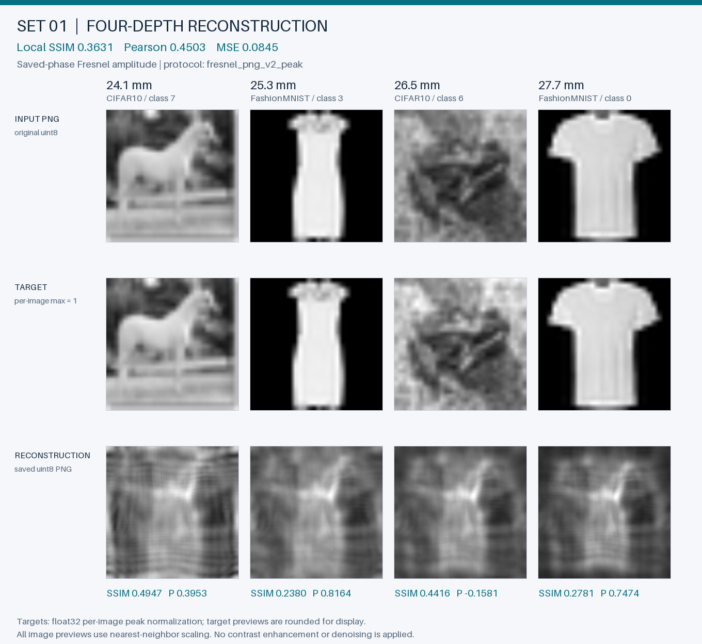
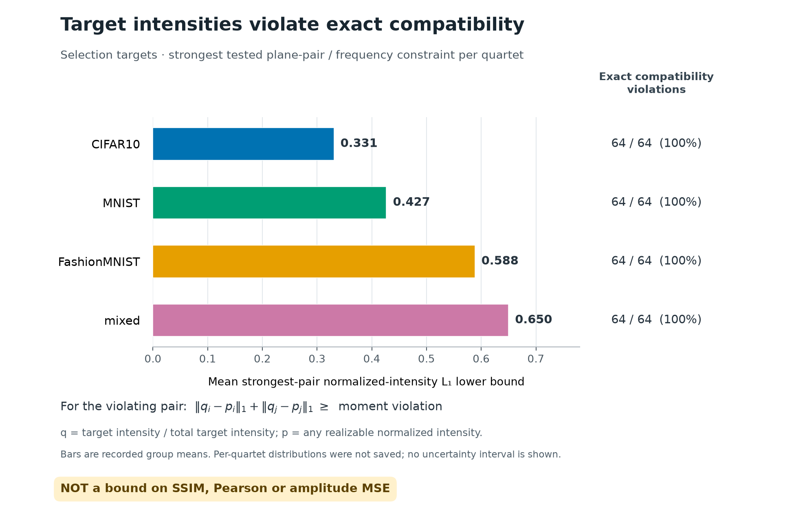
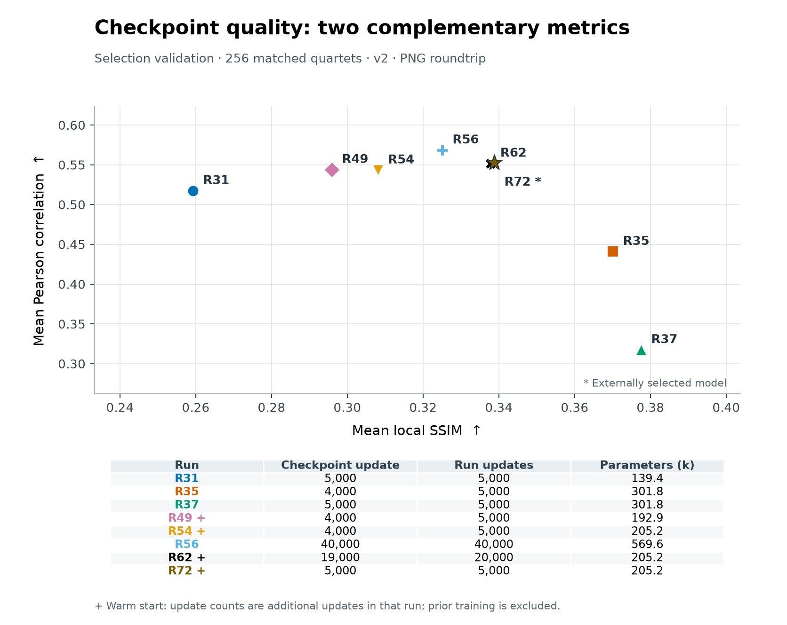

# Четыре изображения — один фазовый ДОЭ

[](https://github.com/memily0/neural-holography/actions/workflows/docker-smoke.yml?query=branch%3Adzprht%2Fneural-holography-20261108)

Однопроходный нейросетевой синтез дифракционного оптического элемента. На входе — четыре изображения; на выходе — одна фазовая маска для приближённого восстановления целевых **амплитуд** на четырёх заданных глубинах. Обученные веса включены в репозиторий, готовое решение работает на CPU без сети.

Идея решения — обучить представление комплексного поля, согласованное с физикой распространения и фазовой симметрией. Нейросеть учится через фиксированный оптический декодер, без готовых фазовых меток и без оптимизации маски для отдельного входа.

| Выпущенная модель | Значение |
|---|---|
| Архитектура / исследовательский запуск | **transport_spatial_complex** / `r72_spatial_frequency_control` |
| Обучаемых параметров | 205 188 |
| Протокол | `fresnel_png_v2_peak` |
| Выбранный шаг | 5000 дополнительного этапа R72; 33 000 обновлений в цепочке выбранных состояний |
| Обучение выбранной ветки, включая предшествующие этапы | 35 000 выполненных обновлений в четырёх этапах; 27,82 мин суммарного измеренного времени обучения |
| Веса и проверяемое происхождение | [models/solution.pt](models/solution.pt) · [models/metadata.json](models/metadata.json) |



Первый из пяти комплектов, выбранных **до оценки модели и без отбора по score**. Все пять, фазовые маски, метрики по глубинам и исходные PNG доступны в [локальной HTML-галерее](docs/demo/index.html); происхождение входов — в [examples/manifest.json](examples/manifest.json). Для просмотра галереи откройте `docs/demo/index.html` из локальной копии репозитория. На всех комплектах сохранены заметные межплоскостные помехи. Изображения позволяют оценить ограничение качества непосредственно.

## Запуск готового решения

Нужны четыре обычных PNG **128×128, grayscale, 8 бит**. Их порядок задаёт глубины: **24,1 → 25,3 → 26,5 → 27,7 мм**. Датасеты и GPU для inference не нужны.

Сборка Docker и запуск всех пяти включённых комплектов:

```bash
git clone --branch dzprht/neural-holography-20261108 https://github.com/memily0/neural-holography.git
cd neural-holography
docker build --platform linux/amd64 -t neural-holography:solution .
mkdir -p results

for set in 1 2 3 4 5; do
  docker run --rm --network none \
    --mount "type=bind,source=$(pwd)/examples/input_set${set},target=/input,readonly" \
    --mount "type=bind,source=$(pwd)/results,target=/output" \
    neural-holography:solution \
    --inputs /input/image1.png /input/image2.png /input/image3.png /input/image4.png \
    --output "/output/set${set}"
done
```

Интернет требуется для клонирования и сборки образа; контейнер выше выполняется с отключённой сетью. Для своих изображений замените каталог, подключаемый как `/input`. Каталог результата `results/setN` должен отсутствовать: программа сохраняет предыдущие результаты и отказывается их перезаписывать.

Каждый запуск создаёт пять обязательных изображений:

```text
results/set1/
├── phase.png                  # одна фазовая маска, 128×128, L
├── reconstruction_1.png       # амплитуда на 24,1 мм
├── reconstruction_2.png       # амплитуда на 25,3 мм
├── reconstruction_3.png       # амплитуда на 26,5 мм
├── reconstruction_4.png       # амплитуда на 27,7 мм
├── target_1.png … target_4.png # точные копии входов для проверки
└── metrics.json               # SSIM/Pearson по плоскостям, средние, SHA-256
```

<details>
<summary>Те же пять комплектов в PowerShell</summary>

После клонирования и перехода в репозиторий:

```powershell
docker build --platform linux/amd64 -t neural-holography:solution .
New-Item -ItemType Directory -Force results | Out-Null
foreach ($set in 1..5) {
  docker run --rm --network none --mount "type=bind,source=$((Get-Location).Path)/examples/input_set$set,target=/input,readonly" --mount "type=bind,source=$((Get-Location).Path)/results,target=/output" neural-holography:solution --inputs /input/image1.png /input/image2.png /input/image3.png /input/image4.png --output "/output/set$set"
}
```

</details>

<details>
<summary>Python 3.11 без Docker</summary>

```bash
python3.11 -m venv .venv-runtime
.venv-runtime/bin/python -m pip install -r requirements.txt
.venv-runtime/bin/python -m src.predict \
  --checkpoint models/solution.pt --device cpu \
  --inputs examples/input_set1/image1.png examples/input_set1/image2.png examples/input_set1/image3.png examples/input_set1/image4.png \
  --output results/python_set1
```

На Windows создайте окружение через `py -3.11 -m venv .venv-runtime` и используйте `.venv-runtime\Scripts\python.exe`. Версии inference закреплены: PyTorch **2.6.0+cpu**, NumPy **1.26.4**, Pillow **11.3.0**. Подробности установки и экспорта — в [DEPLOYMENT.md](DEPLOYMENT.md).

</details>

## Почему комплексное представление

Фаза — периодическая величина. Независимая обработка действительной и мнимой частей обычными операциями не обязана сохранять её геометрию. Здесь обучаемые комплексные смешивания и действительные gates, зависящие от модулей признаков, согласованы с симметрией общего фазового поворота. Такой поворот изменяет фазу поля, сохраняя его физическую амплитуду.

```mermaid
flowchart LR
    I["4 входных PNG"] --> N["Нормировка каждой цели<br/>по собственному максимуму"]
    subgraph NET["Нейросеть: один прямой проход"]
        E["Обучаемый encoder<br/>целевых фаз"] --> C["Комплексные признаки<br/>A · exp(iψ)"]
        C --> T["Фиксированный сопряжённый<br/>перенос в координаты ДОЭ"]
        T --> D["Обучаемый комплексный decoder<br/>с gates по модулю"]
        D --> P["Два выходных компонента<br/>круговая параметризация фазы"]
    end
    N --> E
    N --> C
    P --> Q["Одна 8-битная<br/>phase.png"]
    Q --> F["Прямое восстановление Френеля<br/>на четырёх глубинах"]
    F --> A["Модуль поля · peak-нормировка<br/>4 PNG восстановлений"]
    classDef learned fill:#dceef5,stroke:#086f83,color:#15283e;
    classDef physics fill:#edf2e8,stroke:#667c45,color:#15283e;
    class E,D,P learned;
    class T,F physics;
```



Сопряжённый перенос здесь преобразует **обучаемые признаки**; окончательную единственную фазовую маску синтезирует нейросеть. В обучении ошибка восстановленных амплитуд проходит через дифференцируемую физику и обновляет общие веса. При inference веса фиксированы, цикл подгонки отсутствует.

GS/Фиенапа, классические фазовые метки, развёрнутые итерации и оптимизация ДОЭ на отдельном примере не используются. Конкретная конфигурация выбранной ветки и функции потерь: **TARGET U-Net, обучаемые целевые фазы и общий phase bias; сопряжённый перенос комплексных признаков; SOURCE decoder с комплексными 3×3 смешиваниями и gates по модулю, width 16, circular head. Loss: MSE + (1−SSIM) + 0,5·(1−Pearson) + 2·balanced pixel MSE + 0,1·excess concentration. Полная конфигурация — [selected_training_config.json](experiments/final/selected_training_config.json)**. Мотивация, контрольные варианты и источники описаны в [заметке о комплексном декодере](RESEARCH_NOTES_COMPLEX_DECODER.md) и [плане экспериментов](EXPERIMENT_PLAN.md).

## Физика и сохранённые PNG

Равномерное единичное освещение, длина волны **532 нм**, шаг пиксела ДОЭ **10 мкм**, размер маски **128×128**. Используется single-FFT формула Френеля:

$$
U_z(x,y)=\frac{e^{ikz}}{i\lambda z}\,e^{i\pi(x^2+y^2)/(\lambda z)}
\mathcal F_{u,v}\!\left[e^{i\phi(u,v)}e^{i\pi(u^2+v^2)/(\lambda z)}\right]
\bigg|_{f_x=x/(\lambda z),\ f_y=y/(\lambda z)},\qquad k=\frac{2\pi}{\lambda}.
$$

Центрированная дискретная сетка использует индексы `−64…63`. Шаг выходной плоскости определяется формулой **Δxₙ = λzₙ / (NΔu)**; он не одинаков для всех глубин. В реализации `norm="ortho"` физический масштаб равен `NΔu²/(λz)`.

| Плоскость | Расстояние | Выходной шаг |
|---|---:|---:|
| 1 | 24,1 мм | 10,0166 мкм |
| 2 | 25,3 мм | 10,5153 мкм |
| 3 | 26,5 мм | 11,0141 мкм |
| 4 | 27,7 мм | 11,5128 мкм |

Маска кодируется как `q = round(255·(φ+π)/(2π))`, где `φ ∈ [−π, π]`. Коды 0 и 255 соответствуют эквивалентным фазовым концам. Восстановление вычисляется **после записи и повторного чтения** `phase.png`, поэтому оценка относится к сдаваемой 8-битной маске.

Протокол `fresnel_png_v2_peak`: каждая исходная цель делится на свой максимум; каждый модуль поля **|U|**, а не интенсивность |U|², также делится на свой максимум. Затем восстановление округляется в PNG и перечитывается для метрик. Нормированная цель для метрик остаётся float32; её отдельное изображение в галерее округлено только для отображения. Нулевая цель остаётся нулевой, неопределённый Pearson явно отмечается.

Основная метрика — локальный SSIM: Gaussian **11×11**, sigma **1,5**, `data_range=1`, valid crop. Дополнительно сохраняются Pearson, MSE и whole-image SSIM. Окно SSIM в исходном задании не было фиксировано, поэтому наша конвенция указана явно. Проверки прямой дискретной суммы Френеля, градиентов и кодирования находятся в [tests/test_physics.py](tests/test_physics.py).

## Как оценивалось качество

Используются **CIFAR10, MNIST, FashionMNIST**. Из исходных обучающих частей выделено 10% изображений на стратифицированную validation-выборку, seed 42. Разделение идёт по исходным изображениям, затем собираются четвёрки; grayscale и resize до 128×128 выполняются воспроизводимо.

Короткая selection-валидация состоит из 256 четвёрок: по 64 из каждого датасета и 64 смешанных. Дополнительные резервы исключают исходные изображения уже просмотренных selection-комплектов; после анализа результатов такой резерв становится частью открытого исследования. Пять иллюстративных наборов также относятся к selection validation и не служат независимой оценкой обобщения.

Официальные test split трёх датасетов открываются **после фиксации одного checkpoint** и не используются для выбора весов. Это test самих датасетов, не скрытая проверка организаторов. Статус итогового прогона: **завершён для одного заранее зафиксированного R72 и фиксированного baseline R31; 1024 четвёрки / 4096 восстановлений на модель**.

| Проверка одного финального checkpoint | Четвёрок | Локальный SSIM ↑ | Pearson ↑ | Whole-image SSIM ↑ |
|---|---:|---:|---:|---:|
| Selection validation | 256 | 0,338846 | 0,552719 | 0,454589 |
| Резерв по новым исходным изображениям | 512 | 0,336068 | 0,553651 | 0,456814 |
| Официальные test split | 1024 | 0,338003 | 0,562046 | 0,462934 |

Усреднение равномерное по четырём плоскостям и четвёркам. Групповые и попримерные результаты, SHA checkpoint и manifests: **[протокол и результаты](experiments/final/README.md), [фиксация кандидатов](experiments/final/frozen_candidates.json), [фиксация победителя до test](experiments/final/frozen_winner.json), [попарное сравнение на test](experiments/final/test_comparison.json)**. Конкретные ограничения качества: **сильное наложение объектов между глубинами, особенно на цифрах; прохождение brightness/Pearson guards не означает высокого визуального качества. Выбранная ветка обучена с одним seed; устойчивость к новым seed не установлена**.


На тех же 1024 test-четвёрках R31: **SSIM 0,256118 / Pearson 0,524574**. Изменение R72−R31: SSIM **+0,081884**, условный 95% интервал [0,079243; 0,084691]; Pearson **+0,037473**, интервал [0,035540; 0,039417]. Это парный стратифицированный bootstrap по 2000 повторов целых четвёрок. Источники могут повторяться между четвёрками: интервалы условны по наблюдаемым комплектам, не являются confidence intervals по независимым исходным изображениям.

| Official test, по 256 четвёрок | SSIM | Pearson |
|---|---:|---:|
| CIFAR10 | 0,469652 | 0,375518 |
| MNIST | 0,343168 | 0,670106 |
| FashionMNIST | 0,261809 | 0,678795 |
| mixed | 0,277382 | 0,523767 |

### Скорость и проверки

| CPU, batch 1, четыре потока | Измерение |
|---|---:|
| Один нейросетевой forward, warm median | 20,12 мс |
| Нормировка → сеть → маска → Френель → uint8, warm median | 21,64 мс |
| Отдельный CLI-процесс с загрузкой весов, PNG I/O и метриками | 1,872 с |

Машина и полные условия измерения: **Intel Core i3-12100F, Windows, PyTorch 2.6.0+cpu; 50 повторов после 10 прогревов, 4 потока; [полный benchmark](experiments/final/benchmark_cpu.json)**. Warm-измерения не включают чтение диска, загрузку модели и расчёт метрик. Проверки финального экспорта на CPU: **[190 полных host-тестов и 173 теста без датасетов](experiments/final/host_verification.json); [точное совпадение пяти PNG и метрик до/после экспорта на первом фиксированном комплекте](experiments/final/export_validation.json)**. Статус Docker: **[актуальный результат для этой ветки в GitHub Actions](https://github.com/memily0/neural-holography/actions/workflows/docker-smoke.yml?query=branch%3Adzprht%2Fneural-holography-20261108)**; [workflow](.github/workflows/docker-smoke.yml) проверяет оптическую математику и выполняет inference с `--network none`.

## Что изменилось по ходу исследования

- Автоэнкодеры, Fourier-блоки, attention и периодические выходные головы помогли проверить представление фазы, но сами по себе не устранили смешение соседних глубин.
- Рост SSIM оказался недостаточным признаком успеха. В одном v2-опыте R37 SSIM достиг 0,3776, однако Pearson упал до 0,3174, а объекты потемнели из-за ярких пиков после max-нормировки. Этот дефект проверялся по яркости foreground, концентрации энергии и визуально; такой результат не был принят за хорошее решение.
- Комплексный декодер и ограничения на яркость/концентрацию возникли из этих наблюдений. Контрольные эксперименты отделяют эффект архитектуры от функции потерь, инициализации и бюджета. Проверка межплоскостной связи объясняет часть сложности, но не доказывает невозможность задачи или верхнюю границу score.

Отдельно получено необходимое условие совместимости четырёх целей с дискретным оператором задачи: различие Fourier-моментов нормированной интенсивности соседних плоскостей ограничено нормой коммутатора их операторов переноса. Все 128 проверенных TRAIN-четвёрок и 256 selection-четвёрок нарушают хотя бы одно из проверенных условий. Это исключает **точное совпадение всех четырёх амплитудных форм для этих комплектов** даже при произвольной входной амплитуде. Это не верхняя граница SSIM/Pearson и не доказательство оптимальности нашей сети. Вывод и проверки доступны в [математической заметке](experiments/moment_compatibility_bound.md).



Полная история, включая неудачные ветки: [EXPERIMENT_LOG.md](EXPERIMENT_LOG.md). Машинный [реестр запусков](experiments/run_registry.json) хранит конфигурации, метрики, бюджеты, кривые валидации и контрольные суммы. Старый `fresnel_png_v1` и новый `fresnel_png_v2_peak` разделены: их числа нельзя напрямую сравнивать. Всего завершено **73 (30 в историческом v1 и 43 в v2, включая 3 диагностических запуска)** исследовательских запусков; суммарный зарегистрированный бюджет — **5,18 ч суммы зарегистрированного времени обучения. Часть CPU/GPU работы выполнялась параллельно; это не длительность всей сессии и не GPU-only benchmark**.



R35/R37 показывают высокий SSIM при провале дополнительных проверок. График использует исходные GPU-оценки исследовательских запусков; итоговая таблица выше — повторная оценка выбранного checkpoint в CPU runtime. [Кривые обучения](docs/research/selection_learning_curves.png) и [происхождение рисунков](docs/research/figure_provenance.json) сохраняют бюджеты и этапы продолжения.

## Воспроизведение

Данные восстанавливаются из исходных источников с проверкой контрольных сумм:

```bash
python scripts/download_data.py --root data
python scripts/download_data.py --root data --verify-only
```

Архивы датасетов, промежуточные checkpoint, локальные вложения и выгрузка чата не входят в Git/Docker. [data/README.md](data/README.md) описывает источники и размещение. [requirements-train.txt](requirements-train.txt) фиксирует использованную исследовательскую среду **Python 3.14 / PyTorch 2.14.0+cu130**, GPU RTX 5060 Ti. Её следует устанавливать в отдельное окружение; NumPy 2.5.4 требует Python ≥3.12. Для готового CPU-решения используется отдельное окружение **Python 3.11** с `requirements.txt`.

Точная команда обучения выбранной ветки, включая необходимые этапы переноса весов:

```bash
python -m src.train \
  --run r46_peak_transport_complex_guard \
  --model transport_complex \
  --phase-head circular \
  --position xy \
  --steps 5000 \
  --eval-every 1000 \
  --ssim-weight 1.0 \
  --pearson-weight 0.5 \
  --balanced-weight 2.0 \
  --concentration-weight 0.1

python -m src.train \
  --run r54_peak_spatial_complex_guard \
  --model transport_spatial_complex \
  --phase-head circular \
  --position xy \
  --steps 5000 \
  --eval-every 1000 \
  --ssim-weight 1.0 \
  --pearson-weight 0.5 \
  --balanced-weight 2.0 \
  --concentration-weight 0.1 \
  --resume outputs/r46_peak_transport_complex_guard/best.pt

python -m src.train \
  --run r62_long_spatial_complex \
  --model transport_spatial_complex \
  --phase-head circular \
  --position xy \
  --steps 20000 \
  --lr 0.0001 \
  --lr-schedule cosine \
  --warmup-steps 200 \
  --eval-every 1000 \
  --ssim-weight 1.0 \
  --pearson-weight 0.5 \
  --balanced-weight 2.0 \
  --concentration-weight 0.1 \
  --save-every-eval \
  --resume outputs/r54_peak_spatial_complex_guard/best.pt

python -m src.train \
  --run r72_spatial_frequency_control \
  --model transport_spatial_complex \
  --phase-head circular \
  --position xy \
  --steps 5000 \
  --lr 5e-05 \
  --lr-schedule cosine \
  --warmup-steps 200 \
  --eval-every 1000 \
  --ssim-weight 1.0 \
  --pearson-weight 0.5 \
  --balanced-weight 2.0 \
  --concentration-weight 0.1 \
  --save-every-eval \
  --resume outputs/r62_long_spatial_complex/best.pt
```

После обучения:

```bash
python -m scripts.export_solution --checkpoint outputs/r72_spatial_frequency_control/step_005000.pt --output-dir outputs/reproduced_model
python -m scripts.build_demo --checkpoint outputs/reproduced_model/solution.pt --output outputs/reproduced_demo
python -m scripts.archive_research
python -m unittest discover -s tests -v
```

Команды воспроизводят использованные настройки; численное обучение может зависеть от GPU/runtime. Для точного inference используйте включённые веса и зафиксированное CPU-окружение. [Цепочка обучения и бюджеты](experiments/final/training_lineage.json) различает все выполненные обновления и состояния, от которых продолжалась следующая стадия.

Для повторного экспорта/галереи укажите новые выходные каталоги: опубликованные результаты защищены от случайной перезаписи. Экспорт содержит только CPU-веса, минимальную конфигурацию и provenance, без optimizer state. Диагностические веса с `fixed_train_quartets > 0` не допускаются к выпуску. Проверка SHA связывает выбранный исследовательский checkpoint, переносимый файл и демонстрацию.

| Материал | Содержание |
|---|---|
| [TASK_BRIEF.md](TASK_BRIEF.md) | Краткое задание, физические параметры, уточнения нормировки |
| [EXPERIMENT_PLAN.md](EXPERIMENT_PLAN.md) | Гипотезы и научные источники |
| [EXPERIMENT_LOG.md](EXPERIMENT_LOG.md) | Измеренные результаты, ограничения и следующие проверки |
| [experiments/run_registry.json](experiments/run_registry.json) | Публичный машинный архив завершённых запусков |
| [DEPLOYMENT.md](DEPLOYMENT.md) | Docker, CPU runtime, экспорт и загрузка данных |
| [docs/demo/index.html](docs/demo/index.html) | Автономная галерея пяти фиксированных комплектов |
| [docs/presentation/solution.pptx](docs/presentation/solution.pptx) · [PDF](docs/presentation/solution.pdf) | Презентация для пятиминутной защиты |
| [docs/presentation/speaker_notes.md](docs/presentation/speaker_notes.md) | План выступления и ответы на вопросы |
